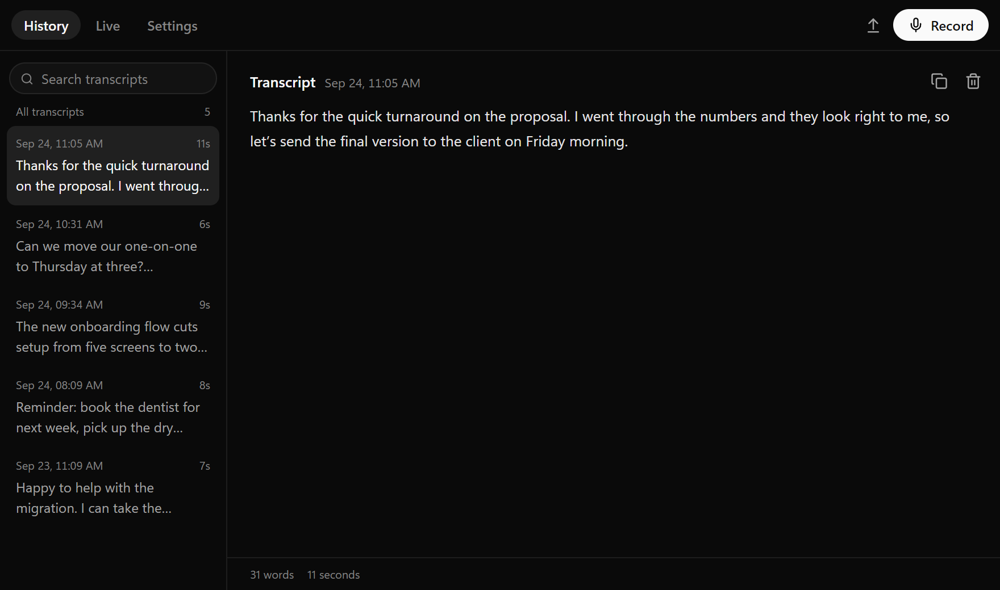

<div align="center">


# Transcribe

**Speak instead of typing.** Press a shortcut, talk, and clean text lands in whatever app you're using.

[](https://github.com/awidor/Transcribe/releases/latest)
[](#install)

**[Download the latest release](https://github.com/awidor/Transcribe/releases/latest)**

<br>


</div>

## Why Transcribe

- **Works in any app.** A small pill floats over your screen while you talk. When you stop, the text is pasted where your cursor is.
- **See your words as you speak.** Transcription streams live, so the pill shows each word as you say it, and the text is ready the moment you stop. Turn **Streaming** off to send each recording to MAI-Transcribe-2 or, through OpenRouter, Voxtral Small Transcribe 3 once you stop instead.
- **Hear it start and stop.** A soft chime plays when recording starts and another when it ends.
- **Cleans up what you say, if you want.** Filler words, stutters, and false starts disappear and punctuation is fixed, while your wording stays your own. Turn cleanup off to paste exactly what you said.
- **Nothing gets lost.** Every dictation is saved to History, where you can search, edit, and copy it. If a paste fails, the pill holds on to the text so you can drag it where it belongs.
- **Changed your mind?** Press `Esc` while dictating to cancel and discard it.
- **Import recordings.** Transcribe WAV, MP3, and FLAC files.
- **Stays up to date.** New versions install from Settings in one click.



## Install

Download the installer for your platform from the [latest release](https://github.com/awidor/Transcribe/releases/latest).

| Platform      | Download                                                         |
| ------------- | ---------------------------------------------------------------- |
| Windows (x64) | `Transcribe-win-Setup.exe`                                       |
| Linux (x64)   | the `.deb` or `.rpm` package for GNOME, or `Transcribe.AppImage` |

SHA-256 checksums for every download are in `SHA256SUMS.txt` on the release page.

> [!NOTE]
> The Windows installer isn't signed with a publisher certificate, so when SmartScreen appears, choose **More info**, then **Run anyway**.

## Get started

1. Create a [Microsoft Foundry or Speech resource](https://portal.azure.com/#create/Microsoft.CognitiveServicesAIFoundry) in a region that serves MAI-Transcribe-2-Streaming, such as Sweden Central or East US 2. No model deployment is needed.
2. Open **Settings** and add the resource's key under **Azure key**. For cleanup or Voxtral transcription through OpenRouter, add an [OpenRouter API key](https://openrouter.ai/keys) too.
3. Click into any text field, press the shortcut, and start talking. Press it again to stop, and the text is pasted in.

| Action                  | Shortcut               |
| ----------------------- | ---------------------- |
| Start or stop dictation | `Ctrl` `Shift` `Space` |
| Cancel and discard      | `Esc`                  |

Record a different shortcut in Settings. A dictation stops on its own after five minutes.

### Cleanup

Cleanup runs through OpenRouter with the model you choose. You can instead download **S1-mini by Superwhisper** in Settings to clean up transcripts on your own machine, with a style from casual to formal, or set **Cleanup** to **Off**.

**MAI-Transcribe-2** has Azure leave out filler words while it transcribes, with no separate cleanup step. It needs the whole recording and MAI-Transcribe-2 itself, so choosing it turns **Streaming** off and sets **Transcription** to MAI-Transcribe-2, and turning **Streaming** off with MAI-Transcribe-2 chooses it.

### Updates

Installed with the Windows setup or run as the AppImage, Transcribe checks for new versions in the background. When one is ready, Settings shows it with an **Install and restart** button. The `.deb` and `.rpm` packages update by installing the newer package.

## Privacy

Transcribe has no account and no server of its own. Besides the services you add keys for, it only contacts GitHub to check for updates, and Hugging Face and GitHub if you download S1-mini.

| What                         | Where it goes                                                                                            |
| ---------------------------- | -------------------------------------------------------------------------------------------------------- |
| Dictation and imported audio | Azure, streamed or sent whole for transcription, or OpenRouter with Voxtral. Transcribe doesn't save it. |
| Transcripts                  | OpenRouter for cleanup, or nowhere with S1-mini, MAI-Transcribe-2 or with cleanup turned off             |

History and API keys stay on your computer. API keys are stored as plain text, not in the system keychain.

---

## Development

This part is for working on Transcribe itself. To use it, [install a release](#install).

Transcribe is a C++20 core with a native shell for each platform: GTK 4 and libadwaita on GNOME, and WinUI 3 on Windows.

### Requirements

- Linux: CMake, Ninja, a C++20 compiler, and these libraries (Ubuntu 26.04 names):

```sh
sudo apt-get install cmake ninja-build g++ pkg-config libcurl4-openssl-dev libssl-dev \
  libsqlite3-dev nlohmann-json3-dev libarchive-dev libsoxr-dev libminiaudio-dev libglib2.0-dev \
  libgio-2.0-dev-bin libevdev-dev libxcb1-dev libxcb-xinput-dev libxcb-xtest0-dev libx11-dev \
  libwayland-dev libwayland-bin libgtest-dev libgtkmm-4.0-dev libadwaita-1-dev \
  libgtk4-layer-shell-dev libayatana-appindicator-glib-dev
```

- Windows: Visual Studio 2022 with the C++ desktop workload, and [vcpkg](https://vcpkg.io).

### Build from source

On Linux:

```sh
git clone https://github.com/awidor/Transcribe.git
cd Transcribe
cmake -S . -B build -G Ninja
cmake --build build
build/shells/gnome/transcribe
```

On Windows, in a Developer PowerShell for Visual Studio 2022:

```powershell
cmake -S . -B build -G Ninja -DCMAKE_BUILD_TYPE=Release -DVCPKG_TARGET_TRIPLET=x64-windows-static-md `
  "-DCMAKE_TOOLCHAIN_FILE=$env:VCPKG_ROOT\scripts\buildsystems\vcpkg.cmake"
cmake --build build
msbuild shells\windows\Transcribe.vcxproj /restore /p:Configuration=Release /p:Platform=x64
build\windows\Release\Transcribe.exe
```

### Test

```sh
ctest --test-dir build --output-on-failure
```

### Package

On Linux, `cpack` in `build/` writes the `.deb` and `.rpm` packages. The Windows installer and the AppImage are built with [Velopack](https://velopack.io) by the release workflow.

### Release

Bump the version in `CMakeLists.txt`, then push a matching tag such as `v0.3.0`. GitHub Actions checks both platforms, builds the Windows installer and the Linux packages, and drafts the release. Publishing the draft makes it available to installed copies.
